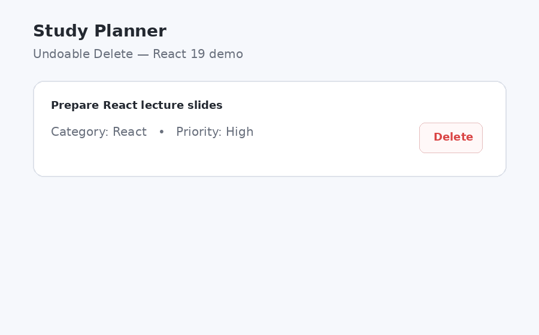

= Лабораторна робота №9

*Тема:* React State та Effects: Context API, useReducer, useEffect і Custom Hooks.

*Мета:* навчитися організовувати стан React-застосунку, коли одного локального `useState` стає недостатньо.
Опанувати підняття стану, Context API, `useReducer`, побічні ефекти, роботу з `localStorage` та створення власних hooks.

Лабораторна є продовженням лабораторної роботи №8.
Необхідно продовжити розробку застосунку **Study Planner** без втрати попереднього функціоналу.

Рекомендована feature-гілка: `feature/state-effects`.

== Вимоги до звіту

. Використовувати React 19.x та Node.js 22.22 або новішу версію.
. Використовувати TypeScript.
. Використовувати функціональні компоненти та hooks.
. Використати Context API для спільного стану.
. Використати `useReducer` щонайменше для одного набору пов'язаних змін стану.
. Використати `useEffect` для роботи з побічним ефектом.
. Реалізувати збереження даних у `localStorage`.
. Винести повторно використовувану логіку в Custom Hook.
. Для стилізації використати один із підходів: SCSS із дотриманням BEM, Bootstrap або Tailwind CSS.
. Якщо обрано SCSS, дотримуватися BEM-патерну для класів.
. Дотримуватися ESLint та єдиного стилю коду.
. Код повинен бути розміщений в особистому GitHub репозиторії студента.
. Дотримуватися Conventional Commits.

== Теоретична частина

Опрацювати:

. https://react.dev/learn/managing-state[Managing State].
. https://react.dev/learn/sharing-state-between-components[Sharing State Between Components].
. https://react.dev/learn/extracting-state-logic-into-a-reducer[Extracting State Logic into a Reducer].
. https://react.dev/learn/scaling-up-with-reducer-and-context[Scaling Up with Reducer and Context].
. https://react.dev/learn/synchronizing-with-effects[Synchronizing with Effects].
. https://react.dev/learn/reusing-logic-with-custom-hooks[Reusing Logic with Custom Hooks].

== Стилізація та BEM

Для стилізації обрати один із трьох підходів:

. **SCSS + BEM** — власні стилі з класами за схемою Block__Element--Modifier;
. **Bootstrap** — готові utility та component класи;
. **Tailwind CSS** — utility-first класи.

Не потрібно поєднувати всі три підходи одночасно.

Якщо обрано **SCSS + BEM**:

* стилі кожного компонента або логічного UI-блоку зберігати у власному `.scss` файлі поруч із компонентом;
* не зберігати стилі компонентів у загальному `App.css` або іншому великому спільному файлі;
* класи повинні відповідати BEM;
* глобальні стилі залишати лише для справді глобальних речей: `body`, базові стилі, шрифти, reset тощо.

== Практична частина

=== 1. Розвиток Study Planner

Продовжити проєкт з лабораторної роботи №8.
Не видаляти вже реалізований функціонал.

Функціонал №8 вже вважається виконаним і не є окремим завданням цієї роботи:
* створення завдання;
* зміна стану виконання;
* видалення;
* базова фільтрація;
* статистика;
* повідомлення для порожнього списку;
* індикація активного фільтра;
* передача state та callback через props там, де вона вже реалізована.

У №9 потрібно не повторювати ці рішення, а **перебудувати організацію state та додати persistence**.

=== 2. Refactoring state через useReducer

Замінити основний `tasks` state з лабораторної №8 на `useReducer`.

Reducer повинен підтримувати щонайменше такі дії:

* `add` — додавання завдання;
* `toggle` — зміна completed;
* `update` — редагування завдання;
* `requestDelete` — запуск Undoable Delete;
* `confirmDelete` — остаточне видалення після завершення таймера;
* `undoDelete` — скасування запланованого видалення;
* `clearCompleted` — масове видалення виконаних, лише якщо для нього реалізовано власний undo-flow;
* `reset` — повернення до початкових даних.

Для кожної дії використати TypeScript-тип action з необхідними payload.

Reducer повинен залишатися чистою функцією:
* не виконувати HTTP-запити;
* не звертатися до DOM;
* не працювати безпосередньо з `localStorage`;
* не містити UI-логіку.

=== 3. Редагування завдання

Додати можливість редагувати існуюче завдання.

Студент повинен мати можливість змінити щонайменше:

* `title`;
* `description`;
* `priority`;
* `category`.

Можна повторно використати `TaskForm` з лабораторної №8, додавши режим редагування.

При збереженні зміни повинні проходити через `dispatch` та reducer, а не змінювати об'єкт завдання напряму.

=== 4. Context API

Створити `TaskContext` та `TaskProvider`.

Context повинен надати компонентам доступ до спільного стану та операцій без передачі `tasks`, `filter` і callback-функцій через декілька рівнів props.

Рекомендований API Context:

[source,typescript]
----
{
  tasks,
  filter,
  setFilter,
  addTask,
  updateTask,
  toggleTask,
  requestDelete,
  undoDelete,
  clearCompleted,
  resetTasks,
  toast
}
----

Конкретна форма API може відрізнятися. Головне — компоненти не повинні знати деталі reducer та timer-логіки.

Реалізація може відрізнятися, але компоненти не повинні отримувати один і той самий state через зайві рівні props.

=== 5. Custom Hooks

Створити щонайменше два власні hooks:

* `useTaskContext()` — зручний доступ до `TaskContext`;
* `useLocalStorage<T>()` — повторно використовувана робота зі сховищем браузера, наприклад для активного фільтра.

`useTaskContext()` повинен мати зрозумілу помилку, якщо його використали поза `TaskProvider`.

`tasks` повинні залишатися єдиним state, яким керує reducer. `useLocalStorage` не повинен створювати друге джерело правди для списку завдань.

Не потрібно створювати окремий hook для кожної дрібної функції.

=== 6. localStorage та useEffect

Зберігати `tasks` у `localStorage`.

Рекомендований сценарій:

. під час ініціалізації reducer прочитати збережені задачі, якщо вони є;
. якщо даних немає або вони пошкоджені, використати початковий список;
. після зміни `tasks` синхронізувати актуальне значення з `localStorage` через `useEffect`;
. обробити помилку `JSON.parse`, щоб пошкоджені дані не ламали застосунок;
. активний фільтр можна зберігати через `useLocalStorage`.

У результаті reducer залишається єдиним джерелом правди для `tasks`, а `localStorage` лише зберігає їх між перезавантаженнями.

Не використовувати `useEffect` для обчислення filtered list або статистики — це derived state і він повинен обчислюватися під час render.

=== 7. Синхронізація з браузером

Додати невеликий Effect, який синхронізує заголовок вкладки браузера з кількістю невиконаних завдань.

Наприклад:

[source]
----
Study Planner — 3 active tasks
----

Для цього використати `document.title` у `useEffect`.

Це окремий приклад синхронізації React state із зовнішнім API браузера.

=== 8. Toast-повідомлення

Створити власний компонент `Toast` без сторонньої бібліотеки.

Toast використовувати для короткого зворотного зв'язку після основних дій:

* успішне створення завдання;
* успішне редагування;
* остаточне видалення;
* помилка операції або неможливість виконати дію.

Toast повинен:

* мати зрозумілий текст;
* автоматично зникати через короткий проміжок часу;
* не блокувати роботу з рештою інтерфейсу.

Для стилізації не потрібно створювати окрему notification-бібліотеку.

=== 9. Undoable Delete

Замість миттєвого видалення реалізувати **Undoable Delete**.

Після натискання «Видалити»:

. не видаляти завдання остаточно одразу;
. позначити його як таке, що очікує видалення;
. показати Toast із повідомленням на кшталт «Завдання буде видалено»;
. запустити таймер на **5 секунд**;
. показувати в Toast візуальний прогрес таймера;
. надати кнопку **«Скасувати» / «Undo»**;
. якщо користувач натиснув Undo — скасувати таймер і повернути завдання до звичайного стану;
. якщо таймер завершився — виконати `confirmDelete` і видалити завдання остаточно.

Під час очікування видалення завдання повинно мати помітний візуальний стан, наприклад приглушення або напис «Буде видалено».

Оскільки таймер є side effect, його не можна створювати всередині reducer.
Reducer лише змінює state, а `useEffect` відповідає за запуск та очищення таймера.

Під час unmount компонента або зміни pending deletion попередній timer повинен бути очищений через `clearTimeout`.

На базовому рівні достатньо підтримувати **одне активне Undoable Delete одночасно**.
Підтримка черги з кількох одночасних видалень — додаткове завдання.

Видалення повинно залишатися undoable у межах поточної сесії. Після перезавантаження сторінки незавершене видалення не потрібно відновлювати.

=== Візуальний приклад Undoable Delete

Щоб було зрозуміло, як очікується поведінка механізму Undoable Delete, нижче наведено короткий візуальний приклад.

У прикладі показано два сценарії:

* натискання «Delete» → запускається 5-секундний таймер → користувач натискає «Undo» → таймер скасовується, завдання повертається у список;
* натискання «Delete» → таймер завершується → виконується остаточне видалення.

Це лише *приклад поведінки та UX*, а не готова реалізація, яку потрібно копіювати один в один.

=== 10. UX після refactoring

Після перенесення state у reducer і Context зберегти функціонал №8:

* фільтрацію;
* derived statistics;
* повідомлення для порожнього списку;
* візуальний стан виконаного завдання.

Ці можливості потрібно зберегти, але не реалізовувати вдруге окремою логікою.

Додати до UI:

* кнопку «Очистити виконані» — лише як додаткову можливість із власним undo-flow;
* кнопку «Скинути дані»;
* режим редагування завдання;
* Toast після create/edit/delete;
* Undoable Delete з прогресом 5 секунд.

=== 11. Додаткові завдання

Для підвищення оцінки можна реалізувати один або декілька пунктів:

. синхронізацію змін між відкритими вкладками через `storage` event;
. відновлення останньої видаленої задачі;
. окремий `ThemeContext` зі збереженням теми;
. підтримку кількох одночасних Undoable Delete;
. масове видалення виконаних із можливістю Undo;
. оптимізацію `Context value`, щоб не створювати новий object без потреби;
. використання `useEffectEvent` там, де це справді доречно, з поясненням, чому звичайний Effect має інші залежності.
== Рекомендована структура

[source]
----
src/
├── components/
│   ├── TaskForm.tsx
│   └── Toast.tsx
├── context/
│   └── TaskContext.tsx
├── hooks/
│   ├── useTaskContext.ts
│   └── useLocalStorage.ts
├── reducers/
│   └── taskReducer.ts
├── types/
├── data/
├── App.tsx
└── main.tsx
----

Структура може бути змінена, якщо відповідальність модулів залишається зрозумілою. Не потрібно створювати окремий модуль для кожної функції або будувати складну feature-first/FSD-архітектуру: у цій лабораторній головною метою є організація state та side effects.

== Демонстрація на захисті

За час захисту необхідно продемонструвати:

. створення або редагування завдання та Toast;
. запуск Undoable Delete і кнопку Undo;
. остаточне видалення після завершення таймера;
. перезавантаження сторінки та відновлення даних з `localStorage`;
. роботу компонента, який отримує state або actions через Context;
. у коді показати `useReducer`, `useEffect`, `useTaskContext` та `useLocalStorage`.

Не потрібно демонструвати всі додаткові можливості.

Приклад Conventional Commit:

[source]
----
feat(lab-09): add reducer context and persistence
----

== Контрольні запитання

. Коли state доцільно піднімати у батьківський компонент?
. Що таке prop drilling і яку проблему вирішує Context API?
. Що таке reducer?
Чим reducer відрізняється від звичайної функції оновлення state?
. Якою повинна бути чиста reducer-функція?
. Що таке action і dispatch?
. Коли `useReducer` доцільніше використовувати за `useState`?
. Що таке Context API і з яких основних частин складається його використання?
. Чи потрібно через Context передавати весь state застосунку?
. Що таке side effect у React?
. Для чого використовується `useEffect`?
. Коли запускається Effect і коли виконується cleanup?
. Чому запис у `localStorage` є побічним ефектом?
. Чому timer для Undoable Delete не можна створювати всередині reducer?
. Для чого потрібен `clearTimeout` у cleanup?
. Чому не варто дублювати derived state?
. Що таке Custom Hook?
. Які правила потрібно дотримуватися при створенні власних hooks?
